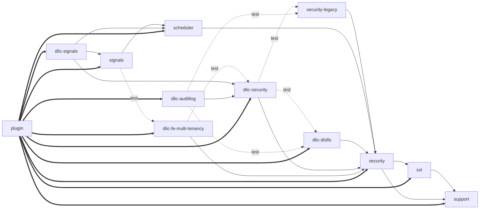

# Build and inter-module dependencies

*Inventory pass, generated 2026-10-19 on branch experimental-analysis at commit 374449897. Every claim carries a file reference. Items marked UNVERIFIED were inferred, not read.*

## Summary for maintainers

*Written for human readers. The tables below are the authoritative record; this section is a guide to them and must be re-read whenever a `pom.xml`, the assembly descriptor or a CI file changes.*

**What this covers.** The Maven modules, which module depends on which, the build profiles, what ends up in the plugin zip, how the version string is derived, and which CI job builds or tests what.

**What you need to know.**

- Twelve modules, ten with production code. Every dependency between modules is provided scope. The only place where all module jars meet is the plugin zip, and nothing is shaded or relocated.
- One zip per exact Elasticsearch patch version. The ES version is baked into the plugin descriptor, and Elasticsearch, Lucene and log4j come from the ES distribution at runtime. There is no build-level compatibility layer.
- Netty is bundled into the zip through the SSL module at compile scope, while the CI vulnerability-scan suppressions claim Netty is provided by Elasticsearch. One of the two statements is wrong.
- The community Signals module needs the proprietary multi-tenancy module for its tests, so a community-only checkout cannot build Signals tests.
- The same code carries three different version strings depending on where it is built: locally, as a CI snapshot, and as a release from a tag.
- Several files are stale: `THIRD-PARTY.txt` names an older ES version and is probably not even in the zip, and the root `CLAUDE.md` names an older ES version than the pom.

**What to review.**

- Section 2, observation 2 on the Signals test dependency (open question 3), and the Netty row in section 6 (open question 4).
- Section 4, the zip contents. They were derived from the assembly descriptor and should be checked once against a real build.
- Section 7, the way unit-test jobs depend on the build job's Maven cache (open question 9).

## Scope and method

Read-only pass over the 13 `pom.xml` files (root + 12 modules), `plugin/src/main/assemblies/*`, `plugin/src/main/descriptor/*`,
`.gitlab-ci.yml`, `.gitlab-ci-branch-specific.yml`, `ci/*.yml`, `ci/*.sh`, `docker/*`, `dev/*.sh`, `settings.xml` and
`THIRD-PARTY.txt`. Counts were computed with `find`/`grep`; no build was run and no `target/` or `~/.m2` content was
produced (an old `~/.m2` listing was only read as evidence). `sgi8/`, `audit/` and `target/` were ignored. Line numbers
are `path:line` in the working tree at the commit above.

## 1. Module inventory

Base `<modules>`: `pom.xml:20-28` (security, security-legacy, scheduler, signals, support, plugin, ssl).
`enterprise` profile `<modules>`: `pom.xml:966-978` (adds the five `dlic-*` modules; omits `ssl`). Effective reactor = union = 12 modules.

| Dir | artifactId (ref) | Packaging | License: pom header | License: Java headers main/test (Apache / "All rights reserved" / none) | main / test .java | Base list | Enterprise profile |
|---|---|---|---|---|---|---|---|
| `support` | `search-guard-flx-support` `support/pom.xml:19` | jar `:20` | Apache 2 `support/pom.xml:2-9` | 31/1/9 ; 9/0/19 | 41 / 28 | yes `pom.xml:25` | yes `pom.xml:971` |
| `ssl` | `search-guard-flx-ssl` `ssl/pom.xml:19` | jar `:20` | Apache 2 `ssl/pom.xml:2-9` | 19/1*/4 ; 15/0/3 | 23 / 18 | yes `pom.xml:27` | **no** (only via base list) |
| `security` | `search-guard-flx-security` `security/pom.xml:19` | jar `:20` | Apache 2 `security/pom.xml:2-9` | 206/2/16 ; 116/0/24 | 224 / 140 | yes `pom.xml:21` | yes `pom.xml:967` |
| `security-legacy` | `search-guard-flx-legacy-test-framework` `security-legacy/pom.xml:19` | jar `:20` | Apache 2 `security-legacy/pom.xml:2-9` | no `src/main` ; 5/0/0 | 0 / 5 | yes `pom.xml:22` | yes `pom.xml:968` |
| `scheduler` | `search-guard-flx-scheduler` `scheduler/pom.xml:19` | jar `:20` | Apache 2 `scheduler/pom.xml:2-9` | 11/1*/28 ; 1/0/6 | 39 / 7 | yes `pom.xml:23` | yes `pom.xml:969` |
| `signals` | `search-guard-flx-signals` `signals/pom.xml:11` | jar `:12` | **no license header** `signals/pom.xml:1-2` | 62/0/190 ; 21/0/17 | 252 / 38 | yes `pom.xml:24` | yes `pom.xml:970` |
| `dlic-security` | `dlic-search-guard-flx-security` `dlic-security/pom.xml:15` | jar `:16` | DLIC "All rights reserved" `dlic-security/pom.xml:2-5` | 2/98/0 ; 3/38/3 | 100 / 44 | no | yes `pom.xml:972` |
| `dlic-signals` | `dlic-search-guard-flx-signals` `dlic-signals/pom.xml:15` | jar `:16` | DLIC `dlic-signals/pom.xml:2-5` | 0/2/7 ; 0/0/2 | 9 / 2 | no | yes `pom.xml:973` |
| `dlic-auditlog` | `dlic-search-guard-flx-auditlog` `dlic-auditlog/pom.xml:15` | jar `:16` | DLIC `dlic-auditlog/pom.xml:2-5` | 1/26/0 ; 0/31/3 | 27 / 34 | no | yes `pom.xml:974` |
| `dlic-dlsfls` | `dlic-search-guard-flx-dlsfls` `dlic-dlsfls/pom.xml:15` | jar `:16` | DLIC `dlic-dlsfls/pom.xml:2-5` | 8/15/2 (2 both) ; 3/15/5 | 23 / 23 | no | yes `pom.xml:975` |
| `dlic-fe-multi-tenancy` | `dlic-search-guard-flx-fe-multi-tenancy` `dlic-fe-multi-tenancy/pom.xml:15` | jar `:16` | DLIC `dlic-fe-multi-tenancy/pom.xml:2-5` | 3/68/13 ; 0/37/0 | 84 / 37 | no | yes `pom.xml:976` |
| `plugin` | `search-guard-flx-elasticsearch-plugin` `plugin/pom.xml:19` | **pom** `:20` | Apache 2 `plugin/pom.xml:2-9` | no Java | 0 / 0 | yes `pom.xml:26` | yes `pom.xml:977` |

`*` = one file carries both phrases (e.g. `ssl/.../DefaultSearchGuardKeyStore.java:1-8` is Apache 2 with an Amazon attribution). Mixed headers inside DLIC modules: `dlic-auditlog/src/main/java/com/floragunn/searchguard/enterprise/auditlog/AuditLogConfig.java:1-8` is Apache 2; `dlic-dlsfls/.../Blake2bDigest.java:1-8` carries the Bouncy Castle licence. Every jar module also produces a `tests` jar: `maven-jar-plugin` `test-jar` execution in `pluginManagement`, `pom.xml:779-806`.

Other `src`-less directories that are not Maven modules: `docker/` (`docker/Dockerfile`, `docker/build_and_push.sh`), `dev/`, `ci/`.

## 2. Inter-module dependency graph

Internal artifacts are version-managed in `pom.xml:87-139` and `pom.xml:325-351` (`tests` classifier). `signals`, `dlic-signals` and `dlic-auditlog` are **not** in `dependencyManagement`; consumers declare `${project.version}` explicitly (`dlic-signals/pom.xml:44,83`, `plugin/pom.xml:92-153`).

| Module | compile | provided | test (plain) | test (`tests` classifier) |
|---|---|---|---|---|
| `support` | - (ES `support/pom.xml:24-27`, provided via root mgmt) | - | - | - |
| `ssl` | `transport-netty4` `ssl/pom.xml:36-47` (external, see 6) | support `ssl/pom.xml:49-53` | - | support:tests `ssl/pom.xml:55-63` |
| `security` | - | ssl `security/pom.xml:91-95`, support `:97-101` | - | support:tests `:103-108` |
| `security-legacy` | - | security `security-legacy/pom.xml:50-54`, ssl `:56-60`, support `:62-66` | - | security:tests `:68-73`, support:tests `:75-80` |
| `scheduler` | - | security `scheduler/pom.xml:35-39`, ssl `:41-47`, support `:49-53` | - | security:tests `:56-61` |
| `signals` | - | scheduler `signals/pom.xml:28-32`, security `:34-38`, ssl `:40-44`, support `:46-50` | **dlic-fe-multi-tenancy** `:58-62` | security:tests `:131-136`, support:tests `:138-143` |
| `dlic-security` | - | security `dlic-security/pom.xml:186-190`, ssl `:192-196`, support `:198-202` | dlic-dlsfls `:204-208` | security:tests `:306-311`, support:tests `:313-318`, legacy-test-framework:tests `:321-326` |
| `dlic-signals` | - | dlic-security `dlic-signals/pom.xml:23-27`, scheduler `:29-33`, security `:35-39`, signals `:41-46`, support `:48-52` | ssl `:54-58` | security:tests `:73-78`, signals:tests `:80-86`, support:tests `:87-92` |
| `dlic-auditlog` | - | dlic-security `dlic-auditlog/pom.xml:33-37`, security `:38-42`, ssl `:44-48`, support `:50-54` | dlic-dlsfls `:57-62` | security:tests `:64-69`, legacy-test-framework:tests `:71-76`, support:tests `:78-83` |
| `dlic-dlsfls` | - | security `dlic-dlsfls/pom.xml:20-24`, support `:26-30` | ssl `:32-36` | security:tests `:38-43`, support:tests `:45-50` |
| `dlic-fe-multi-tenancy` | - | security `dlic-fe-multi-tenancy/pom.xml:20-24`, ssl `:26-30`, support `:32-36` | dlic-security `:39-44` | security:tests `:77-82`, support:tests `:84-89` |
| `plugin` (profile `dlic`, default) | dlic-auditlog, dlic-dlsfls, dlic-fe-multi-tenancy, dlic-security, dlic-signals, scheduler, security, signals, ssl, support, `opensaml-xmlsec-impl` `plugin/pom.xml:92-160` | - | - | - |
| `plugin` (profile `quick`) | identical list `plugin/pom.xml:242-309` | - | - | - |

Observations:

| # | Observation | Ref |
|---|---|---|
| 1 | Every internal production dependency is `provided`; only `plugin` (pom packaging) holds them at compile scope. The plugin zip is therefore the only place where all jars meet. | all module poms above; `plugin/pom.xml:92-160` |
| 2 | Community module `signals` has a test dependency on enterprise module `dlic-fe-multi-tenancy`; its tests exercise tenancy (`signals/src/test/java/com/floragunn/signals/RestApiTestMultiTenancyOff.java`, `.../api/TenantAccountApiTest.java`). A community-only checkout (no `dlic-*` dirs) cannot compile `signals` tests without that artifact from a repository. UNVERIFIED that this is intentional. | `signals/pom.xml:58-62` |
| 3 | `security-legacy` has no `src/main`; its value is the `tests` jar consumed by `dlic-security` and `dlic-auditlog`. | `security-legacy/pom.xml:50-80`; `dlic-security/pom.xml:321-326`; `dlic-auditlog/pom.xml:71-76` |
| 4 | No cycles: dlic-security(test)->dlic-dlsfls->security; dlic-fe-multi-tenancy(test)->dlic-security; signals(test)->dlic-fe-multi-tenancy. Reactor order (derived): support, ssl, security, security-legacy, scheduler, dlic-dlsfls, dlic-security, dlic-fe-multi-tenancy, signals, dlic-signals, dlic-auditlog, plugin. UNVERIFIED (not run). | poms above |
| 5 | `pom.xml:325-330` manages `dlic-search-guard-flx-security:tests` but no module declares it (grep). Leftover from the removed `dlic-security-legacy` module (commit 374449897). | `pom.xml:325-330` |

Solid = `provided` (transitive ssl/support edges omitted for readability); dotted = `test`; thick = `compile` in `plugin`.

## 3. Profiles

| Pom | Profile | Activation | What it changes | Ref |
|---|---|---|---|---|
| root | `enterprise` | `<file><exists>dlic-security</exists>` | Adds `dlic-security`, `dlic-signals`, `dlic-auditlog`, `dlic-dlsfls`, `dlic-fe-multi-tenancy` (plus repeats of base modules; `ssl` not listed) | `pom.xml:959-979` |
| root | `release` | manual (`-Prelease`; also `releaseProfiles` of maven-release-plugin) | Adds `maven-source-plugin` (attach-sources) and `maven-gpg-plugin` (sign at `verify`) from `pluginManagement` | `pom.xml:981-995`; mgmt `pom.xml:748-778`; mgmt release config `pom.xml:735-747`; used by `.gitlab-ci.yml:153` |
| root | `coverage` | manual | JaCoCo `prepare-agent`, `prepare-agent-integration`, `report` at `verify`, `append=true` | `pom.xml:996-1030` |
| `security` | `test-ssl-hostname-verification` | `activeByDefault=false` (manual) | Surefire `includes` = only `SslHostnameVerificationTest.java`; clears default excludes (`combine.self="override"`) | `security/pom.xml:138-159`; default excludes `security/pom.xml:126-133`; used by `ci/backend-unit-tests.yml:49` |
| `plugin` | `dlic` | `activeByDefault=true` | Declares all 10 module jars + `opensaml-xmlsec-impl` as deps; `maven-assembly-plugin` (zip to `target/releases`, no assembly-id suffix); `build-helper` attaches `searchguard-test-instance-installer.sh` as classifier `demo-installer`/type `sh`; `checksum-maven-plugin` SHA-512 of `*.zip` | `plugin/pom.xml:87-239` |
| `plugin` | `quick` | manual (`-Pquick`) | Same deps; only the assembly execution (no demo-installer attach, no checksum). Per Maven semantics an explicit `-P` on this pom deactivates `activeByDefault` `dlic`, which is why the dependency list is duplicated. | `plugin/pom.xml:240-335`; used by `setup_test_instance.sh:14` and `security/src/test/java/com/floragunn/searchguard/test/helper/cluster/SgPluginPackage.java:94` |

Non-profile per-module build overrides: `signals` surefire `forkCount=2` `signals/pom.xml:149-160`; `dlic-dlsfls` JaCoCo always on plus surefire `-Xmx3072m`, `rerunFailingTestsCount=0` (overrides root's 3 at `pom.xml:826`) `dlic-dlsfls/pom.xml:56-94`; `security` excludes `**/*$*` and `SslHostnameVerificationTest` `security/pom.xml:123-134`.

## 4. Plugin zip contents

Assembly descriptor: `plugin/src/main/assemblies/plugin.xml`; bound in both `plugin` profiles (`plugin/pom.xml:163-183`, `:312-332`), output `plugin/target/releases/`, `appendAssemblyId=false` so the file is `search-guard-flx-elasticsearch-plugin-${revision}.zip`.

| Item | Included / excluded | Ref |
|---|---|---|
| All `runtime`-scope dependencies of `plugin` (transitive, strict filtering), flattened to zip root; project artifact itself excluded | included | `plugin.xml:8-16` |
| Hence: 10 SG module jars, `opensaml-xmlsec-impl` and the transitive compile/runtime closure of every module (codova, fluent-collections, guava, jackson-core/smile/yaml, snakeyaml, BC, cxf-jose, nimbus, opensaml-*, java-saml-core, xmlsec, unboundid, quartz, simple-java-mail, httpclient 4/5, **transport-netty4 + netty**, elasticsearch-rest-client, ...) | included | `plugin/pom.xml:92-160`; `THIRD-PARTY.txt:1-101` (99 entries, generated with `license.excludedScopes=test,provided` `pom.xml:67-69`) |
| `provided` deps: `elasticsearch`, `log4j-api`, `log4j-core`, `jakarta.activation-api`, `elasticsearch-scripting-painless-spi`, all internal module-to-module deps | excluded (scope filtering) | `pom.xml:353-368,447-466`; `signals/pom.xml:52-56` |
| `../LICENSE.txt`, `../NOTICE.txt` | included at root | `plugin.xml:18-26` |
| `../security/tools/**` (`install_demo_configuration.sh`), `../security/sgconfig/**` (10 YAML files), mode 0755 | included | `plugin.xml:27-35`; `security/tools`, `security/sgconfig` |
| `plugin-descriptor.properties`, `entitlement-policy.yaml` (filtered copies from `src/main/descriptor` into `plugin/` at `package`; removed by `clean`) | included | `plugin.xml:36-43`; `plugin/pom.xml:30-48,70-83` |
| `THIRD-PARTY.txt` from the fileSet without `<directory>` (defaults to `plugin/` basedir, where no such file exists; the file lives at repo root) | listed, **probably absent from the zip** - UNVERIFIED | `plugin.xml:36-43`; `ls plugin/` shows only `LICENSE.txt`, `pom.xml`, `src` |
| Shading / relocation | none - no `maven-shade-plugin` and no `relocation` in any pom (grep) | all poms |
| Attached side artifacts (not in zip): `*-demo-installer.sh`, `*.zip.sha512` | separate files in `target/releases` | `plugin/pom.xml:184-236` |

Descriptor values (`plugin/src/main/descriptor/plugin-descriptor.properties`): `name=search-guard-flx` `:9`, `classname=com.floragunn.searchguard.SearchGuardPlugin` `:12`, `version=${revision}` `:6`, `java.version=${maven.compiler.release}` (=17, `pom.xml:56`) `:18`, `elasticsearch.version=${elasticsearch.version}` `:25`, `extended.plugins=lang-painless` `:28`. Entitlements (`entitlement-policy.yaml:1-24`): `manage_threads`, `inbound_network`, `outbound_network`, read of three OS files, `write_system_properties` for 11 named properties. No `plugin-security.policy` exists anywhere in the tree (find).

Enterprise classes are wired by name, not by Maven: `security/src/main/java/com/floragunn/searchguard/SearchGuardPlugin.java:345-357` lists `EnterpriseAuthFeaturesModule`, `AuthTokenModule`, `FeMultiTenancyModule`, `DlsFlsModule`, `AuditLogModule`, `SchedulerModule`, `SessionModule`, `SignalsModule` (canonical list and order: extension-points.md §2b); `dlic-signals` is reached through Signals' own extension mechanism (extension-points.md §4, `Signals.java:121-123`).

## 5. Version derivation and CI injection

| Property / place | Value or mechanism | Ref |
|---|---|---|
| `elasticsearch.version` | `9.5.5` | `pom.xml:49` (CLAUDE.md:27 still says 9.4.4; bumped in commit 5a0d3aaae) |
| `sg-suite.version` | `master-SNAPSHOT` | `pom.xml:50` |
| `revision` | `${sg-suite.version}-es-${elasticsearch.version}`; parent and every module use `<version>${revision}</version>` | `pom.xml:51,16`; e.g. `security/pom.xml:16` |
| CI-friendly flattening | `flatten-maven-plugin` `resolveCiFriendliesOnly`, `updatePomFile=true`, at `process-resources` | `pom.xml:898-924` |
| CI `before_script`: `ES_VERSION` | untagged: parsed from `pom.xml` (`xmlstarlet` or `sed`); tagged `sg-flx-<sg>-es-<es>`: both `SG_VERSION` and `ES_VERSION` from the tag | `.gitlab-ci.yml:37-56` |
| `build` job | `mvn -Drevision=$CI_COMMIT_REF_SLUG-SNAPSHOT -Delasticsearch.version=$ES_VERSION -DskipTests clean deploy`; writes `snapshot.env` (dotenv artifact) | `.gitlab-ci.yml:97-110` |
| `deploy_release` job (tags) | `mvn clean deploy -Prelease -Delasticsearch.version=$ES_VERSION -Dsg-suite.version=$SG_VERSION`; `DEPLOY_VERSION=$SG_VERSION-es-$ES_VERSION`; also tags the `sgi8` repo at `<major.minor>.x` | `.gitlab-ci.yml:128-153` |
| `ci/run_tests.sh` | `-Drevision=$SNAPSHOT_REVISION -Delasticsearch.version=$ES_VERSION -Dsg.tests.sg_plugin.file=plugin/target/releases/*SNAPSHOT*.zip -Dsg.tests.es_download_cache.dir=...` | `ci/run_tests.sh:13-19` |
| `scan:build` (security scan) | `-Drevision=trivy -Delasticsearch.version=$ES_VERSION` -> `search-guard-flx-elasticsearch-plugin-trivy.zip` | `ci/security-scan.yml:46,50,60` |
| `ci/Dockerfile.trivy` | `FROM floragunncom/es-mirror:${ES_VERSION}` | `ci/Dockerfile.trivy:1-6` |
| Backend int tests | `sgi8` branch = `IT_BRANCH` or `<ES major.minor>.x`; plugin zip by `${SNAPSHOT_REVISION}` | `ci/backend-int-tests.yml:116-127`; `.gitlab-ci-branch-specific.yml:3-4` |
| Frontend / MT-migration tests | plugin URL resolved via `ci/artifact_uri.sh ... "${CI_COMMIT_REF_SLUG}-SNAPSHOT"`; Kibana plugin from `SG_KI_BRANCH` (`main`) | `ci/frontend-int-tests.yml:20-24`; `ci/mt-data-migration-tests.yml:19-23,55,75`; `.gitlab-ci-branch-specific.yml:2`; `ci/artifact_uri.sh:15-48` |
| `deploy_docker_image` | `SG_VERSION`/`ES_VERSION` from tag; `build_and_push.sh ... "$SG_VERSION-es-$ES_VERSION"`; Dockerfile installs the *released* zip from `maven.search-guard.com` | `.gitlab-ci.yml:172-194`; `docker/Dockerfile:1-12`; `docker/build_and_push.sh:63-83` |
| Plugin descriptor | `version=${revision}`, `elasticsearch.version=${elasticsearch.version}` filtered at `package` | `plugin-descriptor.properties:6,25`; `plugin/pom.xml:30-48` |
| Demo installer | `SG_VERSION_PRE="${project.version}"` filtered; ES version parsed back out of it with `sed 's/^.*-es-\(.*\)*$/\1/p'` | `plugin/src/main/assemblies/searchguard-test-instance-installer.sh:22,37`; `plugin/pom.xml:49-67` |
| Tests building the plugin themselves | if `sg.tests.sg_plugin.file` unset, `MavenCli` runs `install -DskipTests=true -Pquick` on the project root (needs `maven-embedder` test dep) | `SgPluginPackage.java:37-108`; `pom.xml:507-534` |
| External-process cluster ES version | `org.elasticsearch.Version.CURRENT` of the ES jar on the test classpath, i.e. `elasticsearch.version` | `security/src/test/java/com/floragunn/searchguard/test/helper/cluster/ExternalProcessEsCluster.java:191-193` |
| Local helper | `setup_test_instance.sh` builds with `-Pquick` and reads `elasticsearch.version` with `xmlstarlet` | `setup_test_instance.sh:14,22` |
| Jar manifest | `git-sha1=${git.commit.id}` but no plugin defines `git.commit.id` (grep) -> probably the literal string. UNVERIFIED | `pom.xml:792-796` |
| Build toolchain | enforcer: Maven >= 3.8.1, Java >= 17; CI image `floragunncom/ubuntu-openjdk25:251126`; `maven.compiler.release=17` | `pom.xml:851-885,56`; `.gitlab-ci.yml:14` |
| Repositories / credentials | Maven Central, `maven.search-guard.com` (release, snapshot, util, third-party), `artifacts.elastic.co`, Shibboleth, Sonatype snapshots; CI uses `-s settings.xml` with `ARTIFACTORY_USER/PASSWORD` | `pom.xml:605-697`; `settings.xml:6-17`; `.gitlab-ci.yml:17` |

## 6. Notable third-party dependencies

| Dependency | Version | Pinned at | Scope / consumers | Runtime origin |
|---|---|---|---|---|
| `org.elasticsearch:elasticsearch` | `${elasticsearch.version}` = 9.5.5 | `pom.xml:353-368` (excludes `elasticsearch-preallocate`, `exponential-histogram`) | **provided**, inherited by all modules `pom.xml:436-439` | ES distribution |
| Lucene | not pinned; transitive of `elasticsearch` | - | provided (transitive); absent from `THIRD-PARTY.txt` (grep: 0) | ES distribution |
| ES modules at `${elasticsearch.version}`: `elasticsearch-ssl-config`, `elasticsearch-scripting-painless-spi`, `lang-mustache`, `lang-painless`, `rest-root`, `elasticsearch-rest-client`, `parent-join`, `percolator`, `reindex` | 9.5.5 | `pom.xml:250-284,552-571` | mostly `test` (`pom.xml:537-577`); painless-spi **provided** in `signals/pom.xml:52-56`; rest-client **compile** in `dlic-auditlog/pom.xml:27-31` | module jars are not on Central: `dev/populate_maven.sh:4-24,55-59` uploads them from the ES tarball to `third-party` repo |
| `transport-netty4` + Netty | 9.5.5 / Netty not pinned (THIRD-PARTY lists 4.1.135.Final, `THIRD-PARTY.txt:32-39`) | `ssl/pom.xml:36-47` (**compile**, excludes `elasticsearch-ssl-config`) | compile in `ssl` -> runtime in zip | both bundled in zip **and** present as ES module; CI treats Netty as "provided by ES" and ignores its CVEs (`ci/trivy-ignore-policy.rego:23-28`, `ci/owasp-suppressions.xml:10-27`) |
| BouncyCastle `bcpkix-jdk18on` | `bc.version` 1.86 | `pom.xml:58,242-246` | compile: `ssl/pom.xml:30-34`, `security/pom.xml:81-84`, `security-legacy/pom.xml:45-48`, `dlic-security/pom.xml:132-135`; `bcprov`/`bcpkix` excluded from OpenSAML `dlic-security/pom.xml:154-163` | zip; `THIRD-PARTY.txt:68-70` lists bcprov 1.84 **and** 1.86 |
| Jackson | `jackson.version` 2.18.10 | `pom.xml:60,75-79` | root compile: `jackson-core`, `dataformat-smile`, `dataformat-yaml` (snakeyaml excluded, replaced by `snakeyaml:2.7`) `pom.xml:392-422,441-446`; `jackson-databind` test only `pom.xml:469-480` | zip; `THIRD-PARTY.txt:3-4` lists jackson-annotations 2.18.10 and 2.20 |
| `com.floragunn:codova` | 1.10.1 | `pom.xml:81-85` | root compile `pom.xml:419-422` (all modules) | zip |
| `com.floragunn:fluent-collections` | 1.3.0 | `pom.xml:105-109` | `security/pom.xml:25-28` | zip |
| `com.floragunn:search-guard-lpg` | 1.0.0 | `pom.xml:236-240` | `security/pom.xml:76-79`, `security-legacy/pom.xml:40-43` | zip; OWASP-suppressed `ci/owasp-suppressions.xml:29-35` |
| `com.selectivem.collections:special-collections-complete` | 1.4.0 | `pom.xml:377-381` | `security/pom.xml:86-89` | zip |
| OpenSAML | `opensaml.version` 5.2.3 | `pom.xml:63,141-145` | `opensaml-saml-impl` compile in `dlic-security/pom.xml:137-185` (many exclusions); `opensaml-xmlsec-impl` added directly in `plugin/pom.xml:155-158,304-308`; repo `pom.xml:676-685` (Shibboleth) | zip |
| `java-saml-core` 2.9.0, `xmlsec` 4.0.4, `unboundid-ldapsdk` 7.0.5, `httpclient5` 5.6.4, `httpcore5` 5.4.3 | as listed | `dlic-security/pom.xml:44-70,126-131,20-24,78-82,281-304` | compile in `dlic-security` | zip |
| Quartz | 2.5.2 (c3p0 excluded) | `pom.xml:307-317` | `scheduler/pom.xml:30-33` | zip |
| CXF `cxf-rt-rs-security-jose` | `cxf.version` 4.2.3 | `pom.xml:61` | `security/pom.xml:51-69`, `dlic-security/pom.xml:95-113` | zip |
| `nimbus-jose-jwt` 10.10, `ipaddress` 5.6.2, `json-path` 3.0.0 | as listed | `security/pom.xml:70-74,30-34`; `pom.xml:163-167` | compile in `security` | zip |
| Apache HttpClient 4.x: `httpclient` 4.5.14, `httpasyncclient` 4.1.5, `httpcore` 4.4.16, `httpclient-cache` | `http.commons.version` | `pom.xml:62,200-216`; `dlic-security/pom.xml:115-125` | `ssl/pom.xml:24-28` (async), `signals/pom.xml:17-20` | zip |
| `simple-java-mail` 9.3.5 | - | `signals/pom.xml:22-26` | compile | zip |
| Guava 33.7.1-jre | - | `pom.xml:152-156,424-427` | root compile | zip |
| `jakarta.activation` `[1.2.2,1.3)` compile; `jakarta.activation-api` `[2.0.1,2.1.2)` **provided** | version ranges | `pom.xml:429-434,447-454` | root | zip / assumed present |
| log4j | `log4j.version` 2.26.1 | `pom.xml:59,218-234` | `log4j-api`, `log4j-core` **provided** `pom.xml:456-466`; `log4j-slf4j2-impl` test | ES distribution |
| Test only: JUnit 4.13.2, Hamcrest 3.0 (+`hamcrest-core` shim pin), Mockito 5.23.0, WireMock 3.13.2, Awaitility 4.3.0, GreenMail 2.1.13, maven-embedder/compat 3.9.16, ASM 9.10.1 (`org.ow2.asm.version`), antlr4 4.13.2, jjwt 0.13.0 | - | `pom.xml:193-197,286-305,319-323,370-375,507-534,64-65`; `signals/pom.xml:90-123`; `dlic-security/pom.xml:210-236` | test | - |

Unused property: `ldaptive.version` 2.3.2 at `dlic-security/pom.xml:21` has no consumer (grep).

## 7. CI: which job builds or tests what

Pipeline skeleton `.gitlab-ci.yml:63-82` (stages) and includes `.gitlab-ci.yml:75-82`. Global `MAVEN_CLI_OPTS="--batch-mode -s settings.xml -U"`, local repo `.m2/repository` `.gitlab-ci.yml:16-17`.

| Job | File:lines | Modules / scope | Command / notes |
|---|---|---|---|
| `build` | `.gitlab-ci.yml:84-116` | whole reactor (enterprise profile auto-active) | `mvn ... -DskipTests clean deploy`; artifacts `plugin/target/releases/`, `snapshot.env`; pushes `.m2` cache keyed `mavenrepo-$CI_COMMIT_REF_SLUG` (fallback `mavenrepo-main`); skipped on `DOCKER_ONLY` or release tags |
| `build_release` | `.gitlab-ci.yml:118-126` | same | only on `sg-flx-*` tags, artifacts 1 week |
| `.be_unit_test` template | `ci/backend-unit-tests.yml:1-34` | - | stage "Backend Unit Tests", 15 min, `retry: 2`, JUnit from `*/target/surefire-reports`, `.m2` cache **pull only** (so `-pl` without `-am` relies on the `build` job's deploy having installed sibling modules), ES tarball cache `es-download`; skipped on `SKIP-UT`/`SKIP-TESTS`/`DOCKER_ONLY` |
| `test_security` | `:36-41` | `security` | `ci/run_tests.sh security`, 30 min |
| `test_security_SslHostnameVerificationTest` | `:43-49` | `security` with profile `test-ssl-hostname-verification` | separate job because of log volume |
| `test_ssl`, `test_signals`, `test_scheduler`, `test_support` | `:51-74` | `ssl`, `signals`, `scheduler`, `support` | `ci/run_tests.sh <module>` |
| `test_dlic_security`, `test_dlic_dlsfls`, `test_dlic_femt`, `test_dlic_auditlog`, `test_dlic_signals` | `:76-104` | the five `dlic-*` modules | `ci/run_tests.sh <module>` |
| (none) | - | `security-legacy`, `plugin` | no unit-test job; `security-legacy` has only test-harness sources |
| `ci/run_tests.sh` | `ci/run_tests.sh:1-49` | one module | `mvn -pl $MODULE test` with the properties in section 5; optional `-P $PROFILE` `:21-23`; creates and runs as user `es_test` `:24-26,41`; `TEST_CLUSTER_TYPE=full` -> `-Dsg.tests.use_ep_cluster=true`, else `false` `:28-32`; diagnostics via `ci/resource-diagnostics.sh` `:10-11,34-46` |
| `.be_integration_test` + 13 jobs (`community`, `enterprise_1..3`, `ccs_1..3`, `compliance_1..3`, `compliance_ccs`, `signals_1..2`) | `ci/backend-int-tests.yml:2-158` | plugin zip | clones private `sgi8`, copies zip to `docker/elasticsearch/search-guard.zip`, runs `./run_test_definition.sh "$TEST_DEFINITIONS"`; only on MR, schedule, tag or `FORCE_SGI` `:94-98`; dind via `ci/dind-mirror.yml:10-17` |
| `check_frontend_prerequisites` (manual) / `frontend_int_tests` (trigger) | `ci/frontend-int-tests.yml:1-69` | plugin zip from Maven snapshot repo | child pipeline from `search-guard/search-guard-kibana-plugin` at `SG_KI_BRANCH` |
| `Please set DATA_DIR_ARCHIVE_NAME` (manual) / `mt_data_migration_tests` (trigger) | `ci/mt-data-migration-tests.yml:1-87` | plugin zip | needs `DATA_DIR_ARCHIVE_NAME`; child pipeline from the Kibana repo |
| `scan:build`, `scan:trivy:vuln`, `scan:trivy:secrets-misconfig`, `scan:trivy:image`, `scan:owasp:vuln`, `trivy:report:html`, verify gate | `ci/security-scan.yml:43-66,76-134,157-250,254-270,375-413` | whole reactor (`mvn package -Drevision=trivy`), CycloneDX aggregate BOM, zip, image `es-mirror:${ES_VERSION}` + zip | gate failure toggled by `ALLOW_TRIVY_FAILURE` `.gitlab-ci.yml:8` |
| `deploy_release` | `.gitlab-ci.yml:128-153` | whole reactor | GPG via `dev/setup_gpg.sh`; `mvn clean deploy -Prelease ...` |
| `deploy_docker_image` | `.gitlab-ci.yml:155-195` | none (installs released zip) | rules: `sg-*` tag -> run; `DOCKER_ONLY` -> never (evaluated after the tag rule) |
| `backport_automation` | `ci/backport.yml:2-19`; `ci/backport/backport.py:84-96,247-262` | - | on every push; targets taken from MR labels `backport-<branch>` |

## Mixed-cluster and compatibility relevance

| Aspect | Effect | Ref |
|---|---|---|
| `elasticsearch.version` is written into `plugin-descriptor.properties`; ES refuses a plugin built for another ES version | One zip per exact ES patch version; a cluster with nodes on different ES patch levels needs a different zip per node. The SG part of the version (`sg-suite.version`) can be equal across those zips. | `plugin-descriptor.properties:20-25`; `pom.xml:49-51` |
| ES core, Lucene, log4j are `provided` | SG code is compiled against exactly one ES; transport/stream-format compatibility between nodes is whatever ES guarantees for that pair of versions, SG adds no compatibility shim at build level (no shading, no multi-release jars). | `pom.xml:353-368,456-466`; grep for shade: none |
| `transport-netty4` and Netty are shipped **inside** the zip at the version pulled by the ES the zip was built against | A node's SG transport runs on the zip's Netty, not necessarily the one in `modules/transport-netty4` of the running ES (only equal when zip and ES versions match, which the descriptor enforces anyway). `THIRD-PARTY.txt:77` still says 9.5.2 (stale vs pom 9.5.5). | `ssl/pom.xml:36-47`; `THIRD-PARTY.txt:32-39,77` |
| `extended.plugins=lang-painless` | SG needs the `lang-painless` module of the host ES; Signals' painless whitelist is per ES version. | `plugin-descriptor.properties:28`; `signals/src/main/resources/META-INF/services/org.elasticsearch.painless.spi.PainlessExtension` |
| `entitlement-policy.yaml` instead of `plugin-security.policy` | ES 9 entitlement model only; the `main-es8` branch must differ here (UNVERIFIED, not read). | `plugin/src/main/descriptor/entitlement-policy.yaml:1-24` |
| `java.version=17` in descriptor while ES 9 bundles a newer JDK and CI builds on JDK 25 | Bytecode level 17 is compatible with any ES 9 JDK; no `--release` mismatch risk, but code cannot use JDK > 17 APIs. | `plugin-descriptor.properties:18`; `pom.xml:56`; `.gitlab-ci.yml:14` |
| Snapshot `revision` = `<branch-slug>-SNAPSHOT` (no ES suffix) on CI, `master-SNAPSHOT-es-9.5.5` locally, `<sg>-es-<es>` on release | Three naming schemes for the same code; anything comparing plugin versions across nodes (UNVERIFIED whether SG does) sees different strings for equivalent builds. | `.gitlab-ci.yml:97`, `pom.xml:49-51`, `.gitlab-ci.yml:141` |
| Branch-per-ES-line model | ES version is a property of the branch; a mixed ES-major cluster (8.19 + 9.x) means two different source branches and two zips. Tags show both lines released in lockstep (`sg-flx-4.2.0-es-9.5.5`, `sg-flx-4.2.0-es-8.19.23`). | `git tag`; CLAUDE.md:25-30 |
| Version ranges for `jakarta.activation` | Build is not fully reproducible: the resolved version can change between builds without a pom change. | `pom.xml:433,452` |

## Open questions for human review

| # | Question | Ref | Answer |
|---|---|---|---|
| 1 | `CLAUDE.md:27` says `main` is on ES 9.4.4; `pom.xml:49` is 9.5.5 (commit 5a0d3aaae). Also `THIRD-PARTY.txt:76-77` lists ES 9.5.2 artifacts: when is `THIRD-PARTY.txt` regenerated (no lifecycle binding for `license-maven-plugin`, `pom.xml:926-930`)? | | _pending_ |
| 2 | Is `THIRD-PARTY.txt` actually in the zip? The fileSet at `plugin.xml:36-43` has no `<directory>`, so it resolves against `plugin/`, which has no such file. | `plugin.xml:36-43` | _pending_ |
| 3 | `signals` (Apache 2, base list) has a test dependency on proprietary `dlic-fe-multi-tenancy`. Intentional? It breaks a community-only reactor. | `signals/pom.xml:58-62` | _pending_ |
| 4 | Netty is both bundled (compile scope via `ssl`) and declared "provided by ES" in the CVE-ignore rationale. One of the two statements is wrong, or the bundled copy is dead weight. | `ssl/pom.xml:36-47`; `ci/trivy-ignore-policy.rego:23-28`; `ci/owasp-suppressions.xml:10-27` | _pending_ |
| 5 | `THIRD-PARTY.txt` lists two versions each of `bcprov-jdk18on` (1.84, 1.86) and `jackson-annotations` (2.18.10, 2.20): does the zip ship duplicates, and does ES jar-hell checking tolerate it? | `THIRD-PARTY.txt:3-4,68-70` | _pending_ |
| 6 | `pom.xml:325-330` manages `dlic-search-guard-flx-security:tests` with no consumer; `dlic-security/pom.xml:21` defines unused `ldaptive.version`. Leftovers of commit 374449897? | | _pending_ |
| 7 | `git-sha1=${git.commit.id}` in jar manifests: no plugin sets that property, so manifests likely contain the unresolved placeholder. | `pom.xml:795` | _pending_ |
| 8 | CLAUDE.md states the Docker jobs run "only when `DOCKER_ONLY` is set"; `deploy_docker_image` runs on `sg-*` tags and is *never* run when `DOCKER_ONLY` is set without a tag. Which is intended? | `.gitlab-ci.yml:160-164`; CLAUDE.md "docker" bullet | _pending_ |
| 9 | `.be_unit_test` pulls the `.m2` cache but never pushes it and has no `needs:`; correctness of `-pl <module>` depends on the `build` job having run `deploy` (which also installs) in the same pipeline and the cache being restored. Verify there is no race on first pipelines of new branches (fallback key `mavenrepo-main`). | `ci/backend-unit-tests.yml:24-28`; `.gitlab-ci.yml:111-116` | _pending_ |
| 10 | `enterprise` profile re-lists base modules but omits `ssl`; harmless today only because Maven merges module lists. Should the duplicate list be reduced to the five `dlic-*` modules? | `pom.xml:966-978` | _pending_ |
| 11 | Repository `sonatype-nexus-snapshots` (`oss.sonatype.org`) and `util-snapshot` are still configured; are they still needed/reachable? | `pom.xml:636-645,686-696` | _pending_ |
